# ⚡ Competitive Programming Solutions

 

 

 

## 📚 Solved Problems Index

| # | Platform | Problem | Category / Div | Language | Date Solved | Solution |
|:---:|:---:|:---|:---:|:---:|:---:|:---:|
| 1 | **Codeforces** | [432A - Choosing Teams](https://codeforces.com/problemset) | Div. 2 | C++ | 2026-11-17 | [Solution](Codeforces/Div.%202/432A%20-%20Choosing%20Teams) |
| 2 | **Codeforces** | [405A - Gravity Flip](https://codeforces.com/problemset) | Div. 2 | C++ | 2026-11-17 | [Solution](Codeforces/Div.%202/405A%20-%20Gravity%20Flip) |
| 3 | **Codeforces** | [427A - Police Recruits](https://codeforces.com/problemset) | Div. 2 | C++ | 2026-11-16 | [Solution](Codeforces/Div.%202/427A%20-%20Police%20Recruits) |
| 4 | **Codeforces** | [1352A - Sum of Round Numbers](https://codeforces.com/problemset) | Div. 4 | C++ | 2026-11-16 | [Solution](Codeforces/Div.%204/1352A%20-%20Sum%20of%20Round%20Numbers) |
| 5 | **Codeforces** | [61A - Ultra-Fast Mathematician](https://codeforces.com/problemset) | Div. 2 | C++ | 2026-11-16 | [Solution](Codeforces/Div.%202/61A%20-%20Ultra-Fast%20Mathematician) |
| 6 | **Codeforces** | [2285A - Composite Permutation](https://codeforces.com/problemset) | Div. 2 | C++ | 2026-11-15 | [Solution](Codeforces/Div.%202/2285A%20-%20Composite%20Permutation) |
| 7 | **Codeforces** | [2211A - Antimedian Deletion](https://codeforces.com/problemset) | Div. 1 | C++ | 2026-11-15 | [Solution](Codeforces/Div.%201/2211A%20-%20Antimedian%20Deletion) |
| 8 | **Codeforces** | [2200A - Eating Game](https://codeforces.com/problemset) | Div. 3 | C++ | 2026-11-15 | [Solution](Codeforces/Div.%203/2200A%20-%20Eating%20Game) |
| 9 | **Codeforces** | [2204A - Passing the Ball](https://codeforces.com/problemset) | Div. 2 | C++ | 2026-11-13 | [Solution](Codeforces/Div.%202/2204A%20-%20Passing%20the%20Ball) |
| 10 | **Codeforces** | [1985A - Creating Words](https://codeforces.com/problemset) | Div. 4 | C++ | 2026-11-13 | [Solution](Codeforces/Div.%204/1985A%20-%20Creating%20Words) |
| 11 | **Codeforces** | [2290C - Books on a Shelf](https://codeforces.com/problemset) | Div. 4 | C++ | 2026-11-12 | [Solution](Codeforces/Div.%204/2290C%20-%20Books%20on%20a%20Shelf) |
| 12 | **Codeforces** | [2290B - Stubborn Pen](https://codeforces.com/problemset) | Div. 4 | C++ | 2026-11-12 | [Solution](Codeforces/Div.%204/2290B%20-%20Stubborn%20Pen) |
| 13 | **Codeforces** | [2290A - Three Piles](https://codeforces.com/problemset) | Div. 4 | C++ | 2026-11-12 | [Solution](Codeforces/Div.%204/2290A%20-%20Three%20Piles) |
| 14 | **Codeforces** | [32B - Borze](https://codeforces.com/problemset) | Div. 2 | C++ | 2026-11-12 | [Solution](Codeforces/Div.%202/32B%20-%20Borze) |
| 15 | **Codeforces** | [144A - Arrival of the General](https://codeforces.com/problemset) | Div. 2 | C++ | 2026-11-12 | [Solution](Codeforces/Div.%202/144A%20-%20Arrival%20of%20the%20General/144A%20-%20Arrival%20of%20the%20General.cpp) |
| 16 | **Codeforces** | [1873B - Good Kid](https://codeforces.com/problemset) | Div. 4 | C++ | 2026-11-11 | [Solution](Codeforces/Div.%204/1873B%20-%20Good%20Kid) |
| 17 | **Codeforces** | [1409A - Yet Another Two Integers Problem](https://codeforces.com/problemset) | Div. 3 | C++ | 2026-11-10 | [Solution](Codeforces/Div.%203/1409A%20-%20Yet%20Another%20Two%20Integers%20Problem) |
| 18 | **Codeforces** | [2241B - Good times Good times](https://codeforces.com/problemset) | Div. 3 | C++ | 2026-11-09 | [Solution](Codeforces/Div.%203/2241B%20-%20Good%20times%20Good%20times) |
| 19 | **Codeforces** | [2241A - Divide and Conquer](https://codeforces.com/problemset) | Div. 3 | C++ | 2026-11-09 | [Solution](Codeforces/Div.%203/2241A%20-%20Divide%20and%20Conquer) |
| 20 | **Codeforces** | [2254A - Riptide](https://codeforces.com/problemset) | Div. 3 | C++ | 2026-11-09 | [Solution](Codeforces/Div.%203/2254A%20-%20Riptide) |
| 21 | **Codeforces** | [1829A - Love Story](https://codeforces.com/problemset) | Div. 4 | C++ | 2026-11-08 | [Solution](Codeforces/Div.%204/1829A%20-%20Love%20Story) |
| 22 | **Codeforces** | [2126A - Only One Digit](https://codeforces.com/problemset) | Div. 3 | C++ | 2026-11-08 | [Solution](Codeforces/Div.%203/2126A%20-%20Only%20One%20Digit) |
| 23 | **Codeforces** | [2009B - osu!mania](https://codeforces.com/problemset) | Div. 4 | C++ | 2026-11-07 | [Solution](Codeforces/Div.%204/2009B%20-%20osu!mania) |
| 24 | **Codeforces** | [2009A - Minimize!](https://codeforces.com/problemset) | Div. 4 | C++ | 2026-11-07 | [Solution](Codeforces/Div.%204/2009A%20-%20Minimize!) |
| 25 | **Codeforces** | [706B - Interesting drink](https://codeforces.com/problemset) | Div. 2 | C++ | 2026-11-07 | [Solution](Codeforces/Div.%202/706B%20-%20Interesting%20drink) |
| 26 | **Codeforces** | [1791C - Prepend and Append](https://codeforces.com/problemset) | Div. 4 | C++ | 2026-11-06 | [Solution](Codeforces/Div.%204/1791C%20-%20Prepend%20and%20Append) |
| 27 | **Codeforces** | [1791B - Following Directions](https://codeforces.com/problemset) | Div. 4 | C++ | 2026-11-06 | [Solution](Codeforces/Div.%204/1791B%20-%20Following%20Directions) |
| 28 | **Codeforces** | [1399A - Remove Smallest](https://codeforces.com/problemset) | Div. 3 | C++ | 2026-11-05 | [Solution](Codeforces/Div.%203/1399A%20-%20Remove%20Smallest) |
| 29 | **Codeforces** | [1760A - Medium Number](https://codeforces.com/problemset) | Div. 4 | C++ | 2026-11-05 | [Solution](Codeforces/Div.%204/1760A%20-%20Medium%20Number) |
| 30 | **Codeforces** | [1915A - Odd One Out](https://codeforces.com/problemset) | Div. 4 | C++ | 2026-11-05 | [Solution](Codeforces/Div.%204/1915A%20-%20Odd%20One%20Out) |
| 31 | **Codeforces** | [2283B - Rhythmic String](https://codeforces.com/problemset) | Div. 2 | C++ | 2026-11-04 | [Solution](Codeforces/Div.%202/2283B%20-%20Rhythmic%20String) |
| 32 | **Codeforces** | [2283A - Numbers on the Board](https://codeforces.com/problemset) | Div. 2 | C++ | 2026-11-04 | [Solution](Codeforces/Div.%202/2283A%20-%20Numbers%20on%20the%20Board) |
| 33 | **Codeforces** | [581A - Vasya the Hipster](https://codeforces.com/problemset) | Div. 2 | C++ | 2026-11-04 | [Solution](Codeforces/Div.%202/581A%20-%20Vasya%20the%20Hipster) |
| 34 | **Codeforces** | [2266B - Three Piles](https://codeforces.com/problemset) | Div. 3 | C++ | 2026-11-03 | [Solution](Codeforces/Div.%203/2266B%20-%20Three%20Piles) |
| 35 | **Codeforces** | [318A - Even Odds](https://codeforces.com/problemset) | Div. 2 | C++ | 2026-11-03 | [Solution](Codeforces/Div.%202/318A%20-%20Even%20Odds) |
| 36 | **Codeforces** | [1829B - Blank Space](https://codeforces.com/problemset) | Div. 4 | C++ | 2026-11-03 | [Solution](Codeforces/Div.%204/1829B%20-%20Blank%20Space) |
| 37 | **Codeforces** | [1512A - Spy Detected!](https://codeforces.com/problemset) | Div. 3 | C++ | 2026-11-03 | [Solution](Codeforces/Div.%203/1512A%20-%20Spy%20Detected!) |
| 38 | **Codeforces** | [1692A - Marathon](https://codeforces.com/problemset) | Div. 4 | C++ | 2026-11-03 | [Solution](Codeforces/Div.%204/1692A%20-%20Marathon) |
| 39 | **Codeforces** | [579A - Raising Bacteria](https://codeforces.com/problemset) | Div. 2 | C++ | 2026-11-02 | [Solution](Codeforces/Div.%202/579A%20-%20Raising%20Bacteria) |
| 40 | **Codeforces** | [1950C - Clock Conversion](https://codeforces.com/problemset) | Div. 4 | C++ | 2026-11-02 | [Solution](Codeforces/Div.%204/1950C%20-%20Clock%20Conversion) |
| 41 | **Codeforces** | [1950B - Upscaling](https://codeforces.com/problemset) | Div. 4 | C++ | 2026-11-02 | [Solution](Codeforces/Div.%204/1950B%20-%20Upscaling) |
| 42 | **Codeforces** | [1950A - Stair, Peak, or Neither?](https://codeforces.com/problemset) | Div. 4 | C++ | 2026-11-02 | [Solution](Codeforces/Div.%204/1950A%20-%20Stair,%20Peak,%20or%20Neither) |
| 43 | **Codeforces** | [1154A - Restoring Three Numbers](https://codeforces.com/problemset) | Div. 3 | C++ | 2026-11-01 | [Solution](Codeforces/Div.%203/1154A%20-%20Restoring%20Three%20Numbers) |
| 44 | **Codeforces** | [1702A - Round Down the Price](https://codeforces.com/problemset) | Div. 3 | C++ | 2026-11-01 | [Solution](Codeforces/Div.%203/1702A%20-%20Round%20Down%20the%20Price) |
| 45 | **Codeforces** | [1772A - A+B?](https://codeforces.com/problemset) | Div. 3 | C++ | 2026-11-01 | [Solution](Codeforces/Div.%203/1772A%20-%20A+B) |
| 46 | **Codeforces** | [1676A - Lucky?](https://codeforces.com/problemset) | Div. 4 | C++ | 2026-10-31 | [Solution](Codeforces/Div.%204/1676A%20-%20Lucky) |
| 47 | **Codeforces** | [750A - New Year and Hurry](https://codeforces.com/problemset) | Others | C++ | 2026-10-31 | [Solution](Codeforces/Others/750A%20-%20New%20Year%20and%20Hurry) |
| 48 | **Codeforces** | [1999A - A+B Again?](https://codeforces.com/problemset) | Div. 4 | C++ | 2026-10-30 | [Solution](Codeforces/Div.%204/1999A%20-%20A+B%20Again) |
| 49 | **Codeforces** | [230A - Dragons](https://codeforces.com/problemset) | Div. 2 | C++ | 2026-10-30 | [Solution](Codeforces/Div.%202/230A%20-%20Dragons) |
| 50 | **Codeforces** | [723A - The New Year Meeting Friends - 723A - The New Year: Meeting Friends](https://codeforces.com/problemset) | Div. 2 | C++ | 2026-10-30 | [Solution](Codeforces/Div.%202/723A%20-%20The%20New%20Year%20Meeting%20Friends) |
| 51 | **Codeforces** | [25A - IQ test](https://codeforces.com/problemset) | Div. 2 | C++ | 2026-10-30 | [Solution](Codeforces/Div.%202/25A%20-%20IQ%20test) |
| 52 | **Codeforces** | [580A - Kefa and First Steps](https://codeforces.com/problemset) | Div. 2 | C++ | 2026-10-29 | [Solution](Codeforces/Div.%202/580A%20-%20Kefa%20and%20First%20Steps) |
| 53 | **Codeforces** | [785A - Anton and Polyhedrons](https://codeforces.com/problemset) | Div. 2 | C++ | 2026-10-29 | [Solution](Codeforces/Div.%202/785A%20-%20Anton%20and%20Polyhedrons) |
| 54 | **Codeforces** | [133A - HQ9+](https://codeforces.com/problemset) | Div. 2 | C++ | 2026-10-29 | [Solution](Codeforces/Div.%202/133A%20-%20HQ9+) |
| 55 | **Codeforces** | [467A - George and Accommodation](https://codeforces.com/problemset) | Div. 2 | C++ | 2026-10-29 | [Solution](Codeforces/Div.%202/467A%20-%20George%20and%20Accommodation) |
| 56 | **Codeforces** | [69A - Young Physicist](https://codeforces.com/problemset) | Div. 2 | C++ | 2026-10-27 | [Solution](Codeforces/Div.%202/69A%20-%20Young%20Physicist) |
| 57 | **Codeforces** | [96A - Football](https://codeforces.com/problemset) | Div. 2 | C++ | 2026-10-27 | [Solution](Codeforces/Div.%202/96A%20-%20Football) |
| 58 | **Codeforces** | [2266A - Good Contest](https://codeforces.com/problemset) | Div. 3 | C++ | 2026-10-27 | [Solution](Codeforces/Div.%203/2266A%20-%20Good%20Contest/2266A%20-%20Good%20Contest.cpp) |
| 59 | **Codeforces** | [1A - Theatre Square](https://codeforces.com/problemset) | Others | C++ | 2026-10-27 | [Solution](Codeforces/Others/1A%20-%20Theatre%20Square/1A%20-%20Theatre%20Square.cpp) |
| 60 | **LeetCode** | [best-time-to-buy-and-sell-stock](https://leetcode.com/problems/best-time-to-buy-and-sell-stock/) | Introductory Problems | Java | 2026-10-27 | [Solution](LeetCode/Easy/best-time-to-buy-and-sell-stock/best-time-to-buy-and-sell-stock.java) |
| 61 | **LeetCode** | [palindrome-number](https://leetcode.com/problems/palindrome-number/) | Introductory Problems | C++ | 2026-10-27 | [Solution](LeetCode/Easy/palindrome-number/palindrome-number.cpp) |
| 62 | **LeetCode** | [remove-duplicates-from-sorted-array](https://leetcode.com/problems/remove-duplicates-from-sorted-array/) | Introductory Problems | C++ | 2026-10-27 | [Solution](LeetCode/Easy/remove-duplicates-from-sorted-array/remove-duplicates-from-sorted-array.cpp) |
| 63 | **LeetCode** | [sqrtx](https://leetcode.com/problems/sqrtx/) | Introductory Problems | Java | 2026-10-27 | [Solution](LeetCode/Easy/sqrtx/sqrtx.java) |
| 64 | **LeetCode** | [two-sum](https://leetcode.com/problems/two-sum/) | Introductory Problems | C++ | 2026-10-27 | [Solution](LeetCode/Easy/two-sum/two-sum.cpp) |
| 65 | **LeetCode** | [valid-palindrome](https://leetcode.com/problems/valid-palindrome/) | Introductory Problems | Java | 2026-10-27 | [Solution](LeetCode/Easy/valid-palindrome/valid-palindrome.java) |
| 66 | **LeetCode** | [median-of-two-sorted-arrays](https://leetcode.com/problems/median-of-two-sorted-arrays/) | Introductory Problems | C++ | 2026-10-27 | [Solution](LeetCode/Hard/median-of-two-sorted-arrays/median-of-two-sorted-arrays.cpp) |
| 67 | **LeetCode** | [divide-two-integers](https://leetcode.com/problems/divide-two-integers/) | Introductory Problems | C++ | 2026-10-27 | [Solution](LeetCode/Medium/divide-two-integers/divide-two-integers.cpp) |
| 68 | **LeetCode** | [powx-n](https://leetcode.com/problems/powx-n/) | Introductory Problems | Java | 2026-10-27 | [Solution](LeetCode/Medium/powx-n/powx-n.java) |
| 69 | **LeetCode** | [reverse-integer](https://leetcode.com/problems/reverse-integer/) | Introductory Problems | C++ | 2026-10-27 | [Solution](LeetCode/Medium/reverse-integer/reverse-integer.cpp) |
| 70 | **LeetCode** | [search-a-2d-matrix](https://leetcode.com/problems/search-a-2d-matrix/) | Introductory Problems | Java | 2026-10-27 | [Solution](LeetCode/Medium/search-a-2d-matrix/search-a-2d-matrix.java) |
| 71 | **LeetCode** | [search-in-rotated-sorted-array-ii](https://leetcode.com/problems/search-in-rotated-sorted-array-ii/) | Introductory Problems | Java | 2026-10-27 | [Solution](LeetCode/Medium/search-in-rotated-sorted-array-ii/search-in-rotated-sorted-array-ii.java) |
| 72 | **LeetCode** | [search-in-rotated-sorted-array](https://leetcode.com/problems/search-in-rotated-sorted-array/) | Introductory Problems | C++ | 2026-10-27 | [Solution](LeetCode/Medium/search-in-rotated-sorted-array/search-in-rotated-sorted-array.cpp) |
| 73 | **LeetCode** | [sort-colors](https://leetcode.com/problems/sort-colors/) | Introductory Problems | Java | 2026-10-27 | [Solution](LeetCode/Medium/sort-colors/sort-colors.java) |
| 74 | **LeetCode** | [strictly-palindromic-number](https://leetcode.com/problems/strictly-palindromic-number/) | Introductory Problems | Java | 2026-10-27 | [Solution](LeetCode/Medium/strictly-palindromic-number/strictly-palindromic-number.java) |
| 75 | **LeetCode** | [two-sum-ii-input-array-is-sorted](https://leetcode.com/problems/two-sum-ii-input-array-is-sorted/) | Introductory Problems | Java | 2026-10-27 | [Solution](LeetCode/Medium/two-sum-ii-input-array-is-sorted/two-sum-ii-input-array-is-sorted.java) |
| 76 | **CSES** | [CSES-1068 - Weird Algorithm](https://cses.fi/problemset/task/1068) | Introductory Problems | C++ | 2026-10-27 | [Solution](CSES/1068%20-%20Weird%20Algorithm/Weird%20Algorithm.cpp) |
| 77 | **CSES** | [CSES-1069 - Repetitions](https://cses.fi/problemset/task/1069) | Introductory Problems | C++ | 2026-10-27 | [Solution](CSES/1069%20-%20Repetitions/Repetitions.cpp) |
| 78 | **CSES** | [CSES-1070 - Permutations](https://cses.fi/problemset/task/1070) | Introductory Problems | C++ | 2026-10-27 | [Solution](CSES/1070%20-%20Permutations/Permutations.cpp) |
| 79 | **CSES** | [CSES-1083 - Missing Number](https://cses.fi/problemset/task/1083) | Introductory Problems | C++ | 2026-10-27 | [Solution](CSES/1083%20-%20Missing%20Number/Missing%20Number.cpp) |
| 80 | **CSES** | [CSES-1094 - Increasing Array](https://cses.fi/problemset/task/1094) | Introductory Problems | C++ | 2026-10-27 | [Solution](CSES/1094%20-%20Increasing%20Array/Increasing%20Array.cpp) |
| 81 | **CSES** | [CSES-1621 - Distinct Numbers](https://cses.fi/problemset/task/1621) | Introductory Problems | C++ | 2026-10-27 | [Solution](CSES/1621%20-%20Distinct%20Numbers/Distinct%20Numbers.cpp) |
| 82 | **Codeforces** | [2267A - Turn Into a Palindrome](https://codeforces.com/problemset) | Div. 2 | C++ | 2026-10-27 | [Solution](Codeforces/Div.%202/2267A%20-%20Turn%20Into%20a%20Palindrome/2267A%20-%20Turn%20Into%20a%20Palindrome.cpp) |
| 83 | **Codeforces** | [486A - Calculating Function](https://codeforces.com/problemset) | Div. 2 | C++ | 2026-10-26 | [Solution](Codeforces/Div.%202/486A%20-%20Calculating%20Function/486A%20-%20Calculating%20Function.cpp) |
| 84 | **Codeforces** | [271A - Beautiful Year](https://codeforces.com/problemset) | Div. 2 | C++ | 2026-10-26 | [Solution](Codeforces/Div.%202/271A%20-%20Beautiful%20Year/271A%20-%20Beautiful%20Year.cpp) |
| 85 | **Codeforces** | [116A - Tram](https://codeforces.com/problemset) | Div. 2 | C++ | 2026-10-26 | [Solution](Codeforces/Div.%202/116A%20-%20Tram/116A%20-%20Tram.cpp) |
| 86 | **Codeforces** | [677A - Vanya and Fence](https://codeforces.com/problemset) | Div. 2 | C++ | 2026-10-26 | [Solution](Codeforces/Div.%202/677A%20-%20Vanya%20and%20Fence/677A%20-%20Vanya%20and%20Fence.cpp) |
| 87 | **Codeforces** | [266A - Stones on the Table](https://codeforces.com/problemset) | Div. 2 | C++ | 2026-10-26 | [Solution](Codeforces/Div.%202/266A%20-%20Stones%20on%20the%20Table/266A%20-%20Stones%20on%20the%20Table.cpp) |
| 88 | **Codeforces** | [263A - Beautiful Matrix](https://codeforces.com/problemset) | Div. 2 | C++ | 2026-10-26 | [Solution](Codeforces/Div.%202/263A%20-%20Beautiful%20Matrix/263A%20-%20Beautiful%20Matrix.cpp) |
| 89 | **Codeforces** | [112A - Petya and Strings](https://codeforces.com/problemset) | Div. 2 | C++ | 2026-10-26 | [Solution](Codeforces/Div.%202/112A%20-%20Petya%20and%20Strings/112A%20-%20Petya%20and%20Strings.cpp) |
| 90 | **Codeforces** | [443A - Anton and Letters](https://codeforces.com/problemset) | Div. 2 | C++ | 2026-10-25 | [Solution](Codeforces/Div.%202/443A%20-%20Anton%20and%20Letters/443A%20-%20Anton%20and%20Letters.cpp) |
| 91 | **Codeforces** | [617A - Elephant](https://codeforces.com/problemset) | Div. 2 | C++ | 2026-10-24 | [Solution](Codeforces/Div.%202/617A%20-%20Elephant/617A%20-%20Elephant.cpp) |
| 92 | **Codeforces** | [705A - Hulk](https://codeforces.com/problemset) | Div. 2 | C++ | 2026-10-24 | [Solution](Codeforces/Div.%202/705A%20-%20Hulk/705A%20-%20Hulk.cpp) |
| 93 | **Codeforces** | [151A - Soft Drinking](https://codeforces.com/problemset) | Div. 2 | C++ | 2026-10-24 | [Solution](Codeforces/Div.%202/151A%20-%20Soft%20Drinking/151A%20-%20Soft%20Drinking.cpp) |
| 94 | **Codeforces** | [1791A - Codeforces Checking](https://codeforces.com/problemset) | Div. 4 | C++ | 2026-10-22 | [Solution](Codeforces/Div.%204/1791A%20-%20Codeforces%20Checking/1791A%20-%20Codeforces%20Checking.cpp) |
| 95 | **Codeforces** | [2044A - Easy Problem](https://codeforces.com/problemset) | Div. 4 | C++ | 2026-10-22 | [Solution](Codeforces/Div.%204/2044A%20-%20Easy%20Problem/2044A%20-%20Easy%20Problem.cpp) |
| 96 | **Codeforces** | [1669A - Division](https://codeforces.com/problemset) | Div. 4 | C++ | 2026-10-22 | [Solution](Codeforces/Div.%204/1669A%20-%20Division/1669A%20-%20Division.cpp) |
| 97 | **Codeforces** | [148A - Insomnia cure](https://codeforces.com/problemset) | Div. 2 | C++ | 2026-10-21 | [Solution](Codeforces/Div.%202/148A%20-%20Insomnia%20cure/148A%20-%20Insomnia%20cure.cpp) |
| 98 | **Codeforces** | [141A - Amusing Joke](https://codeforces.com/problemset) | Div. 2 | C++ | 2026-10-21 | [Solution](Codeforces/Div.%202/141A%20-%20Amusing%20Joke/141A%20-%20Amusing%20Joke.cpp) |
| 99 | **Codeforces** | [734A - Anton and Danik](https://codeforces.com/problemset) | Div. 2 | C++ | 2026-10-19 | [Solution](Codeforces/Div.%202/734A%20-%20Anton%20and%20Danik/734A%20-%20Anton%20and%20Danik.cpp) |
| 100 | **Codeforces** | [1328A - Divisibility Problem](https://codeforces.com/problemset) | Div. 3 | C++ | 2026-10-19 | [Solution](Codeforces/Div.%203/1328A%20-%20Divisibility%20Problem/1328A%20-%20Divisibility%20Problem.cpp) |
| 101 | **Codeforces** | [1335A - Candies and Two Sisters](https://codeforces.com/problemset) | Div. 3 | C++ | 2026-10-18 | [Solution](Codeforces/Div.%203/1335A%20-%20Candies%20and%20Two%20Sisters/1335A%20-%20Candies%20and%20Two%20Sisters.cpp) |
| 102 | **Codeforces** | [200B - Drinks](https://codeforces.com/problemset) | Div. 2 | C++ | 2026-10-18 | [Solution](Codeforces/Div.%202/200B%20-%20Drinks/200B%20-%20Drinks.cpp) |
| 103 | **Codeforces** | [1807A - Plus or Minus](https://codeforces.com/problemset) | Div. 4 | C++ | 2026-10-18 | [Solution](Codeforces/Div.%204/1807A%20-%20Plus%20or%20Minus/1807A%20-%20Plus%20or%20Minus.cpp) |
| 104 | **Codeforces** | [1899A - Game with Integers](https://codeforces.com/problemset) | Div. 3 | C++ | 2026-10-16 | [Solution](Codeforces/Div.%203/1899A%20-%20Game%20with%20Integers/1899A%20-%20Game%20with%20Integers.cpp) |
| 105 | **Codeforces** | [228A - Is your horseshoe on the other hoof](https://codeforces.com/problemset) | Div. 2 | C++ | 2026-10-16 | [Solution](Codeforces/Div.%202/228A%20-%20Is%20your%20horseshoe%20on%20the%20other%20hoof/228A%20-%20Is%20your%20horseshoe%20on%20the%20other%20hoof.cpp) |
| 106 | **Codeforces** | [510A - Fox And Snake](https://codeforces.com/problemset) | Div. 2 | C++ | 2026-10-15 | [Solution](Codeforces/Div.%202/510A%20-%20Fox%20And%20Snake/510A%20-%20Fox%20And%20Snake.cpp) |
| 107 | **Codeforces** | [59A - Word](https://codeforces.com/problemset) | Div. 2 | C++ | 2026-10-15 | [Solution](Codeforces/Div.%202/59A%20-%20Word/59A%20-%20Word.cpp) |
| 108 | **Codeforces** | [1742A - Sum](https://codeforces.com/problemset) | Div. 4 | C++ | 2026-10-14 | [Solution](Codeforces/Div.%204/1742A%20-%20Sum/1742A%20-%20Sum.cpp) |
| 109 | **Codeforces** | [50A - Domino piling](https://codeforces.com/problemset) | Others | C++ | 2026-10-14 | [Solution](Codeforces/Others/50A%20-%20Domino%20piling/50A%20-%20Domino%20piling.cpp) |
| 110 | **Codeforces** | [1703C - Cypher](https://codeforces.com/problemset) | Div. 4 | C++ | 2026-10-14 | [Solution](Codeforces/Div.%204/1703C%20-%20Cypher/1703C%20-%20Cypher.cpp) |
| 111 | **Codeforces** | [1703B - ICPC Balloons](https://codeforces.com/problemset) | Div. 4 | C++ | 2026-10-14 | [Solution](Codeforces/Div.%204/1703B%20-%20ICPC%20Balloons/1703B%20-%20ICPC%20Balloons.cpp) |
| 112 | **Codeforces** | [1703A - YES or YES](https://codeforces.com/problemset) | Div. 4 | C++ | 2026-10-14 | [Solution](Codeforces/Div.%204/1703A%20-%20YES%20or%20YES/1703A%20-%20YES%20or%20YES.cpp) |
| 113 | **Codeforces** | [996A - Hit the Lottery](https://codeforces.com/problemset) | Div. 2 | C++ | 2026-10-13 | [Solution](Codeforces/Div.%202/996A%20-%20Hit%20the%20Lottery/996A%20-%20Hit%20the%20Lottery.cpp) |
| 114 | **Codeforces** | [469A - I Wanna Be the Guy](https://codeforces.com/problemset) | Div. 2 | C++ | 2026-10-13 | [Solution](Codeforces/Div.%202/469A%20-%20I%20Wanna%20Be%20the%20Guy/469A%20-%20I%20Wanna%20Be%20the%20Guy.cpp) |
| 115 | **Codeforces** | [2256A - Three Numbers on the Blackboard](https://codeforces.com/problemset) | Div. 2 | C++ | 2026-10-13 | [Solution](Codeforces/Div.%202/2256A%20-%20Three%20Numbers%20on%20the%20Blackboard/2256A%20-%20Three%20Numbers%20on%20the%20Blackboard.cpp) |
| 116 | **Codeforces** | [344A - Magnets](https://codeforces.com/problemset) | Div. 2 | C++ | 2026-10-12 | [Solution](Codeforces/Div.%202/344A%20-%20Magnets/344A%20-%20Magnets.cpp) |
| 117 | **Codeforces** | [110A - Nearly Lucky Number](https://codeforces.com/problemset) | Div. 2 | C++ | 2026-10-12 | [Solution](Codeforces/Div.%202/110A%20-%20Nearly%20Lucky%20Number/110A%20-%20Nearly%20Lucky%20Number.cpp) |
| 118 | **Codeforces** | [41A - Translation](https://codeforces.com/problemset) | Div. 2 | C++ | 2026-10-12 | [Solution](Codeforces/Div.%202/41A%20-%20Translation/41A%20-%20Translation.cpp) |
| 119 | **Codeforces** | [546A - Soldier and Bananas](https://codeforces.com/problemset) | Div. 2 | C++ | 2026-10-11 | [Solution](Codeforces/Div.%202/546A%20-%20Soldier%20and%20Bananas/546A%20-%20Soldier%20and%20Bananas.cpp) |
| 120 | **Codeforces** | [281A - Word Capitalization](https://codeforces.com/problemset) | Div. 2 | C++ | 2026-10-11 | [Solution](Codeforces/Div.%202/281A%20-%20Word%20Capitalization/281A%20-%20Word%20Capitalization.cpp) |
| 121 | **Codeforces** | [2167B - Your Name](https://codeforces.com/problemset) | Div. 4 | C++ | 2026-10-10 | [Solution](Codeforces/Div.%204/2167B%20-%20Your%20Name/2167B%20-%20Your%20Name.cpp) |
| 122 | **Codeforces** | [2167A - Square](https://codeforces.com/problemset) | Div. 4 | C++ | 2026-10-10 | [Solution](Codeforces/Div.%204/2167A%20-%20Square/2167A%20-%20Square.cpp) |
| 123 | **Codeforces** | [630A - Again Twenty Five!](https://codeforces.com/problemset) | Others | C++ | 2026-10-10 | [Solution](Codeforces/Others/630A%20-%20Again%20Twenty%20Five!/630A%20-%20Again%20Twenty%20Five!.cpp) |
| 124 | **Codeforces** | [1814A - Coins](https://codeforces.com/problemset) | Div. 2 | C++ | 2026-10-10 | [Solution](Codeforces/Div.%202/1814A%20-%20Coins/1814A%20-%20Coins.cpp) |
| 125 | **Codeforces** | [1030A - In Search of an Easy Problem](https://codeforces.com/problemset) | Others | C++ | 2026-10-10 | [Solution](Codeforces/Others/1030A%20-%20In%20Search%20of%20an%20Easy%20Problem/1030A%20-%20In%20Search%20of%20an%20Easy%20Problem.cpp) |
| 126 | **Codeforces** | [977A - Wrong Subtraction](https://codeforces.com/problemset) | Div. 3 | C++ | 2026-10-10 | [Solution](Codeforces/Div.%203/977A%20-%20Wrong%20Subtraction/977A%20-%20Wrong%20Subtraction.cpp) |
| 127 | **Codeforces** | [791A - Bear and Big Brother](https://codeforces.com/problemset) | Div. 2 | C++ | 2026-10-10 | [Solution](Codeforces/Div.%202/791A%20-%20Bear%20and%20Big%20Brother/791A%20-%20Bear%20and%20Big%20Brother.cpp) |
| 128 | **Codeforces** | [520A - Pangram](https://codeforces.com/problemset) | Div. 2 | C++ | 2026-10-09 | [Solution](Codeforces/Div.%202/520A%20-%20Pangram/520A%20-%20Pangram.cpp) |
| 129 | **Codeforces** | [136A - Presents](https://codeforces.com/problemset) | Div. 2 | C++ | 2026-10-09 | [Solution](Codeforces/Div.%202/136A%20-%20Presents/136A%20-%20Presents.cpp) |
| 130 | **Codeforces** | [339A - Helpful Maths](https://codeforces.com/problemset) | Div. 2 | C++ | 2026-10-08 | [Solution](Codeforces/Div.%202/339A%20-%20Helpful%20Maths/339A%20-%20Helpful%20Maths.cpp) |
| 131 | **Codeforces** | [236A - Boy or Girl](https://codeforces.com/problemset) | Div. 2 | C++ | 2026-10-08 | [Solution](Codeforces/Div.%202/236A%20-%20Boy%20or%20Girl/236A%20-%20Boy%20or%20Girl.cpp) |
| 132 | **Codeforces** | [2275A - In Search of Convenience](https://codeforces.com/problemset) | Div. 3 | C++ | 2026-10-07 | [Solution](Codeforces/Div.%203/2275A%20-%20In%20Search%20of%20Convenience/2275A%20-%20In%20Search%20of%20Convenience.cpp) |
| 133 | **Codeforces** | [122A - Lucky Division](https://codeforces.com/problemset) | Div. 2 | C++ | 2026-10-07 | [Solution](Codeforces/Div.%202/122A%20-%20Lucky%20Division/122A%20-%20Lucky%20Division.cpp) |
| 134 | **Codeforces** | [45A - Codecraft III](https://codeforces.com/problemset) | Others | C++ | 2026-10-07 | [Solution](Codeforces/Others/45A%20-%20Codecraft%20III/45A%20-%20Codecraft%20III.cpp) |
| 135 | **Codeforces** | [479A - Expression](https://codeforces.com/problemset) | Div. 2 | C++ | 2026-10-06 | [Solution](Codeforces/Div.%202/479A%20-%20Expression/479A%20-%20Expression.cpp) |
| 136 | **Codeforces** | [131A - cAPS lOCK](https://codeforces.com/problemset) | Div. 2 | C++ | 2026-10-06 | [Solution](Codeforces/Div.%202/131A%20-%20cAPS%20lOCK/131A%20-%20cAPS%20lOCK.cpp) |
| 137 | **Codeforces** | [52A - 123-sequence](https://codeforces.com/problemset) | Others | C++ | 2026-10-06 | [Solution](Codeforces/Others/52A%20-%20123-sequence/52A%20-%20123-sequence.cpp) |
| 138 | **Codeforces** | [158A - Next Round](https://codeforces.com/problemset) | Others | C++ | 2026-10-05 | [Solution](Codeforces/Others/158A%20-%20Next%20Round/158A%20-%20Next%20Round.cpp) |
| 139 | **Codeforces** | [282A - Bit++](https://codeforces.com/problemset) | Div. 2 | C++ | 2026-10-05 | [Solution](Codeforces/Div.%202/282A%20-%20Bit++/282A%20-%20Bit++.cpp) |
| 140 | **Codeforces** | [1873A - Short Sort](https://codeforces.com/problemset) | Div. 4 | C++ | 2026-10-04 | [Solution](Codeforces/Div.%204/1873A%20-%20Short%20Sort/1873A%20-%20Short%20Sort.cpp) |
| 141 | **Codeforces** | [80A - Panoramix's Prediction](https://codeforces.com/problemset) | Div. 2 | C++ | 2026-10-04 | [Solution](Codeforces/Div.%202/80A%20-%20Panoramix's%20Prediction/80A%20-%20Panoramix's%20Prediction.cpp) |
| 142 | **Codeforces** | [1996A - Legs](https://codeforces.com/problemset) | Div. 3 | C++ | 2026-10-04 | [Solution](Codeforces/Div.%203/1996A%20-%20Legs/1996A%20-%20Legs.cpp) |
| 143 | **Codeforces** | [1866A - Ambitious Kid](https://codeforces.com/problemset) | Others | C++ | 2026-10-04 | [Solution](Codeforces/Others/1866A%20-%20Ambitious%20Kid/1866A%20-%20Ambitious%20Kid.cpp) |
| 144 | **Codeforces** | [1108B - Divisors of Two Integers](https://codeforces.com/problemset) | Div. 3 | C++ | 2026-10-03 | [Solution](Codeforces/Div.%203/1108B%20-%20Divisors%20of%20Two%20Integers/1108B%20-%20Divisors%20of%20Two%20Integers.cpp) |
| 145 | **Codeforces** | [231A - Team](https://codeforces.com/problemset) | Div. 2 | C++ | 2026-10-03 | [Solution](Codeforces/Div.%202/231A%20-%20Team/231A%20-%20Team.cpp) |
| 146 | **Codeforces** | [71A - Way Too Long Words](https://codeforces.com/problemset) | Div. 2 | C++ | 2026-09-30 | [Solution](Codeforces/Div.%202/71A%20-%20Way%20Too%20Long%20Words/71A%20-%20Way%20Too%20Long%20Words.cpp) |
| 147 | **Codeforces** | [4A - Watermelon](https://codeforces.com/problemset) | Div. 2 | C++ | 2026-09-30 | [Solution](Codeforces/Div.%202/4A%20-%20Watermelon/4A%20-%20Watermelon.cpp) |
| 148 | **Codeforces** | [118A - String Task](https://codeforces.com/problemset) | Div. 2 | C++ | 2026-09-30 | [Solution](Codeforces/Div.%202/118A%20-%20String%20Task/118A%20-%20String%20Task.cpp) |

 

  Generated automatically by <a href="https://github.com/Pri8899/CodeSync-Pro-Extension"><b>CodeSync Pro v4.4.0</b></a> · Real-time Competitive Programming Sync Engine

